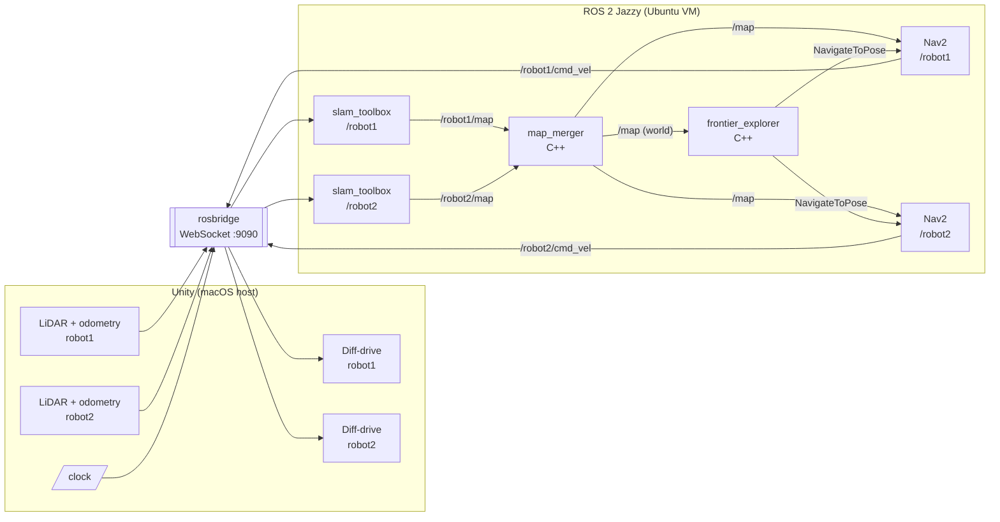

# Multi-Robot Frontier Exploration with Map Merging (Unity + ROS 2 Jazzy)


-000000?logo=unity)


Two TurtleBot3 Burger robots autonomously explore an unknown apartment simulated in Unity.
Each robot runs its own SLAM and Nav2 stack in ROS 2; a C++ map merger fuses both maps into one
shared world map, and a C++ coordinator detects frontiers on that shared map and assigns the robots to
**different** unexplored regions until the whole apartment is mapped.


<p align="center">
  
  <br><em>Merged map, frontiers (yellow), frontier targets (green) and each robot's current goal (red / blue).</em>
</p>

---

## System architecture



**TF tree** (one shared tree on the global `/tf`, robot frames are prefixed):

```
world ──(static, known start pose)──▶ robotN/map ──(slam_toolbox)──▶ robotN/odom
      ──(Unity)──▶ robotN/base_footprint ──▶ robotN/base_link ──▶ robotN/base_scan
```

**Bring-up is layered** so each layer can be restarted and debugged on its own:

| Layer | Launch file | Starts |
|---|---|---|
| Mapping | `mapping.launch.xml` | 2 × slam_toolbox, world TFs, `map_merger`, RViz |
| Navigation | `navigation.launch.xml` | 2 × Nav2 (controller, planner, behaviors, BT navigator) |
| Exploration | `exploration.launch.xml` | `frontier_explorer` |

---

## Methods

### 1. Simulation and sensor bridge (Unity, C#)
- **LiDAR:** 360 raycasts at 5 Hz, 0.12–3.5 m, modelled on the TurtleBot3 LDS-01 → `sensor_msgs/LaserScan`.
- **Odometry:** `odom → base_footprint` TF and `nav_msgs/Odometry` (pose and finite-difference twist).
- **Drive:** kinematic differential drive from `geometry_msgs/Twist`, with sphere-cast collision blocking
  (robots stop at walls, furniture and each other, and roll over obstacles under 5 cm).
- **Time:** a single simulation clock is published on `/clock`; every message is stamped from it
  (`use_sim_time: true` everywhere).
- Transport: ROS# over rosbridge (JSON/WebSocket).


### 2. Per-robot SLAM
`slam_toolbox` (online async) runs once per robot, with namespaced frames and topics and managed as a
lifecycle node. Because the simulator provides drift-free odometry, scan matching and loop closure are
disabled by default: the map is built directly from ground-truth poses, which removes the main source of
mapping error under heavy CPU load. Scan matching can be switched back on (see
[Limitations](#limitations-and-future-work)).

### 3. Map merging with known initial poses (`mrm_mapping/map_merger`)
Each robot's map lives in its own frame (`robotN/map`) whose pose in `world` is the robot's known start
pose, published as a static TF. Once per second the merger:
1. looks up `world → robotN/map` for every map and transforms the four grid corners to compute the
   merged bounding box;
2. allocates a world-aligned grid at the finest input resolution;
3. for each merged cell, transforms its centre into every robot grid and reads the cell value;
4. fuses with **max-occupancy** (`unknown(-1) < free(0) < occupied(100)`): a cell is unknown only if no
   robot has seen it, and an obstacle seen by any robot takes priority over free space.

The output `/map` is latched (transient-local QoS) and is used both by Nav2 (global costmap) and by the explorer.

### 4. Navigation (Nav2, per robot)
- **Global planning** in the `world` frame on the *merged* map, so a robot can plan through rooms its
  teammate mapped. NavFn (A\*), `allow_unknown: true`.
- **Local control:** Regulated Pure Pursuit (low CPU cost) with collision checking on a 3 × 3 m rolling
  local costmap built from the robot's live LiDAR.
- **Recoveries:** spin, back up, wait (default behavior tree).
- A single parameter template (`nav2.yaml`) serves every robot through launch substitutions.

### 5. Coordinated frontier exploration (`mrm_exploration/frontier_explorer`)

**Frontier detection** (pure C++, unit-tested):
- A *frontier cell* is a free cell with at least one unknown 4-neighbour (the map border counts as unknown).
- Frontier cells are grouped into frontiers with an 8-connected flood fill; groups shorter than
  `min_frontier_size` are discarded as noise.
- A brushfire (multi-source BFS from all obstacles) gives every cell its clearance, so goals can be kept
  away from walls.

**Cost and utility.** One BFS from each free robot through known free space gives the true walking
distance to every cell (cheaper than one planner call per frontier). For robot *r* and frontier *f*:

```
utility(r, f) = w_gain · |f| · resolution  −  w_dist · path_length(r, goal_f)
```

**Goal selection per robot and frontier:** the frontier cell nearest the frontier centroid that has enough
clearance, is reachable, is at least `min_goal_distance` from the robot, is not blacklisted for that robot
and lies outside the `separation_radius` of any teammate's goal.

**Task allocation (global greedy).** Repeatedly assign the single best (robot, frontier) pair across all
free robots, mark that robot busy, and continue. The separation rule then pushes the next robot to a
different region. For two robots this matches the optimal assignment in practice; the Hungarian algorithm
is the exact alternative for larger teams.


**Execution and monitoring** (1 Hz loop, asynchronous Nav2 action clients):

| Event | Reaction |
|---|---|
| Goal reached | Spot enters a short *visit grace* period; if the frontier is still there afterwards, it is unexplorable from there → shared blacklist |
| Nav2 aborted / rejected / timed out | Spot blacklisted **for that robot only** (a teammate may still reach it) |
| Target frontier disappears (mapped by anyone) | Re-plan immediately, no need to finish the trip |
| No reachable frontier left | Stop, save the final map, write a run summary |

Goal-handle callbacks carry a sequence number so that late results from preempted goals are ignored.

### 6. Evaluation
Each run writes to `~/mrm_ws/exploration_runs/<run_name>/`:
- `metrics.csv`: time, explored area (m²), number of frontiers, and per-robot distance, goals and failures (1 Hz);
- `map.pgm/.yaml` every 30 s and `map_final.pgm/.yaml` at completion (Nav2 `map_server` format, atomic writes);
- `summary.txt`: time to complete, explored area, per-robot statistics.


---

## Tech stack

| Area | Technology |
|---|---|
| Simulation | Unity 6 (URP), C#, ROS# (`com.siemens.ros-sharp`) |
| Middleware | ROS 2 Jazzy (Ubuntu 24.04), rosbridge_suite |
| SLAM | slam_toolbox (online async) |
| Navigation | Nav2: NavFn, Regulated Pure Pursuit, costmap_2d, behavior trees, lifecycle manager |
| Custom nodes | C++17, rclcpp, rclcpp_action, tf2_ros |
| Build and test | ament_cmake, colcon, GoogleTest (ament_cmake_gtest) |
| Launch | ROS 2 XML launch files with parameter substitution |
| Visualisation | RViz2 (MarkerArray), gnuplot |
| Robot model | TurtleBot3 Burger (URDF imported into Unity) |

---

## Repository structure

```
.
├── Assets/
│   ├── Scenes/Scene_01.unity            # Apartment scene with two TurtleBot3s
│   ├── Scripts/                          # Unity ↔ ROS bridge (C#)
│   │   ├── LidarSensor.cs                #   raycast LiDAR → /robotN/scan
│   │   ├── TfPublisher.cs                #   odom → base_footprint TF + /robotN/odom
│   │   ├── DiffDriveController.cs        #   /robotN/cmd_vel → motion (+ collision blocking)
│   │   ├── ClockPublisher.cs, SimTime.cs #   /clock and shared sim time
│   │   └── CameraSensor.cs               #   optional camera (disabled for mapping)
│   ├── Prefabs/TurtleBot3.prefab
│   └── Tbot3/                            # TurtleBot3 meshes and materials
├── ros2/src/
│   ├── mrm_mapping/                      # C++: map merging
│   │   └── src/map_merger.cpp
│   ├── mrm_exploration/                  # C++: frontier detection and coordinated exploration
│   │   ├── include/mrm_exploration/
│   │   │   ├── frontier_detector.hpp     #   ROS-free algorithms (detection, BFS, brushfire)
│   │   │   └── map_io.hpp                #   ROS-free map saving (.pgm/.yaml)
│   │   ├── src/
│   │   │   ├── frontier_detector.cpp
│   │   │   ├── map_io.cpp
│   │   │   └── frontier_explorer_node.cpp  # ROS node: TF, Nav2 action clients, allocation, metrics
│   │   ├── test/                         #   GoogleTest unit tests
│   │   └── scripts/plot_runs.gp          #   comparison plot
│   └── mrm_bringup/                      # Launch, parameters, RViz (no code)
│       ├── launch/
│       │   ├── mapping.launch.xml        #   2× SLAM + world TFs + merger + RViz
│       │   ├── slam.launch.xml           #   SLAM for one robot
│       │   ├── navigation.launch.xml     #   2× Nav2
│       │   ├── nav.launch.xml            #   Nav2 for one robot
│       │   └── exploration.launch.xml    #   frontier explorer
│       ├── config/
│       │   ├── slam_toolbox.yaml
│       │   ├── nav2.yaml                 #   template, filled per robot
│       │   ├── map_merger.yaml
│       │   └── exploration.yaml
│       └── rviz/mapping.rviz
├── Packages/manifest.json                # Unity packages (pulls ROS# from GitHub)
└── ProjectSettings/
```

---

## ROS 2 interfaces

| Topic / action | Type | Producer → consumer |
|---|---|---|
| `/robotN/scan` | `sensor_msgs/LaserScan` | Unity → slam_toolbox, Nav2 local costmap |
| `/robotN/odom` | `nav_msgs/Odometry` | Unity → Nav2 |
| `/tf`, `/tf_static` | `tf2_msgs/TFMessage` | Unity, slam_toolbox, static publishers |
| `/clock` | `rosgraph_msgs/Clock` | Unity → all nodes |
| `/robotN/map` | `nav_msgs/OccupancyGrid` | slam_toolbox → map_merger |
| `/map` | `nav_msgs/OccupancyGrid` (world frame) | map_merger → Nav2, frontier_explorer, RViz |
| `/robotN/navigate_to_pose` | `nav2_msgs/action/NavigateToPose` | frontier_explorer → Nav2 |
| `/robotN/cmd_vel` | `geometry_msgs/Twist` | Nav2 → Unity |
| `/frontiers` | `visualization_msgs/MarkerArray` | frontier_explorer → RViz |

---

## Getting started

### Requirements

| | Tested with |
|---|---|
| Simulation host | macOS with Unity 6 (see `ProjectSettings/ProjectVersion.txt`) |
| ROS host | Ubuntu 24.04 with ROS 2 Jazzy (a VM works; give it ≥ 4 cores, ≥ 4 GB RAM, 3D acceleration) |
| Network | Both machines able to reach each other (e.g. VMware "Share with my Mac" / NAT) |

> Both sides can also run on one native Ubuntu machine with the Unity Editor for Linux.

### 1. Clone

```bash
git clone https://github.com/<your-username>/multi-robot-exploration-unity-ros2.git
```

### 2. Unity side

1. Open the cloned folder with **Unity Hub** (the Unity version is in `ProjectSettings/ProjectVersion.txt`).
   On first open Unity downloads ROS# automatically from `Packages/manifest.json`.
2. **Import the environment.** The apartment is the free Unity Asset Store package
   [*Apartment Kit* by Brick Project Studio](https://assetstore.unity.com/publishers/48876). Its license
   does not allow redistribution, so it is not included in this repository.
   *Window → Package Manager → My Assets → Apartment Kit → Import.*
3. Open `Assets/Scenes/Scene_01.unity`.
4. Point both robots at the ROS machine: select `turtlebot1` and `turtlebot2` → **Ros Connector** →
   `RosBridgeServerUrl = ws://<ubuntu-ip>:9090` (get the IP with `hostname -I` on Ubuntu).

### 3. ROS 2 side

```bash
# System packages
sudo apt update
sudo apt install -y ros-jazzy-rosbridge-suite ros-jazzy-slam-toolbox \
  ros-jazzy-navigation2 ros-jazzy-nav2-bringup ros-jazzy-teleop-twist-keyboard \
  python3-colcon-common-extensions python3-rosdep gnuplot

# Workspace: link the three packages from the cloned repository
mkdir -p ~/mrm_ws/src && cd ~/mrm_ws/src
REPO=<path-to>/multi-robot-exploration-unity-ros2
ln -s $REPO/ros2/src/mrm_mapping $REPO/ros2/src/mrm_exploration $REPO/ros2/src/mrm_bringup .

# Dependencies, build, tests
cd ~/mrm_ws
sudo rosdep init 2>/dev/null; rosdep update
rosdep install --from-paths src --ignore-src -r -y
source /opt/ros/jazzy/setup.bash
MAKEFLAGS="-j2" colcon build --symlink-install --parallel-workers 1
source install/setup.bash
colcon test --packages-select mrm_exploration && colcon test-result --verbose
```

Add `source /opt/ros/jazzy/setup.bash` and `source ~/mrm_ws/install/setup.bash` to `~/.bashrc`.

---

## Running the system

Start the layers in this order, one terminal each. **After every restart of Unity Play, restart the ROS
launches too**, because the simulation clock restarts at 0.

```bash
# T1: bridge (keep running)
ros2 launch rosbridge_server rosbridge_websocket_launch.xml
#     → press Play in Unity; T1 prints "Client connected" twice

# T2: SLAM for both robots + map merging + RViz
ros2 launch mrm_bringup mapping.launch.xml

# T3: Nav2 for both robots
ros2 launch mrm_bringup navigation.launch.xml

# T4: autonomous coordinated exploration
ros2 launch mrm_bringup exploration.launch.xml explore:=true run_name:=demo
```

In RViz add a **MarkerArray** display on `/frontiers` to see the frontiers and goals.
The run ends with `Exploration complete` and a run summary; results are in `~/mrm_ws/exploration_runs/demo/`.

**Other useful modes**

```bash
# Only visualise frontiers (robots don't move), e.g. while driving manually:
ros2 launch mrm_bringup exploration.launch.xml
ros2 run teleop_twist_keyboard teleop_twist_keyboard --ros-args -r cmd_vel:=/robot1/cmd_vel

# Nav2 for a single robot / single-robot exploration:
ros2 launch mrm_bringup nav.launch.xml robot:=robot2
ros2 launch mrm_bringup exploration.launch.xml robots:=robot2 explore:=true
```

### Changing the robots' start positions

Start poses must match the Unity scene; they define where each robot's map sits in the merged map.
Move a robot in Unity (both robots must stay children of `Robots`, with Play stopped, then save the scene),
then convert its **Inspector** values:

```
x   =  Unity Position Z
y   = −Unity Position X
yaw = −Unity Rotation Y × π / 180
```

and pass them to the mapping launch (or edit the defaults in `mapping.launch.xml`):

```bash
ros2 launch mrm_bringup mapping.launch.xml robot1_x:=4.2 robot1_y:=-18.78 robot1_yaw:=1.5708
```

Wrong values show up immediately as doubled or rotated walls where the two robots' maps meet.

---

## Reproducing the experiments

Three configurations, each started from a fresh simulation (restart Unity Play and all launches between runs):

```bash
ros2 launch mrm_bringup exploration.launch.xml robots:=robot2 explore:=true run_name:=one_robot
ros2 launch mrm_bringup exploration.launch.xml explore:=true coordinated:=false run_name:=two_uncoordinated
ros2 launch mrm_bringup exploration.launch.xml explore:=true run_name:=two_coordinated
```

`coordinated:=false` is the baseline: each robot greedily picks its own best frontier and ignores its
teammate, so both often head for the same place.

Plot explored area over time:

```bash
cd ~/mrm_ws/exploration_runs
gnuplot -c <path-to-repo>/ros2/src/mrm_exploration/scripts/plot_runs.gp \
  one_robot/metrics.csv two_uncoordinated/metrics.csv two_coordinated/metrics.csv
# → exploration_comparison.png
```

---

## Configuration

Most behaviour is tuned in `ros2/src/mrm_bringup/config/` without rebuilding.

| File | Parameter | Default | Meaning |
|---|---|---|---|
| `exploration.yaml` | `gain_weight` / `distance_weight` | 1.0 / 1.0 | Utility trade-off: frontier size vs. path length |
| | `separation_radius` | 1.5 m | Keep goals of different robots apart |
| | `min_frontier_size` | 0.4 m | Ignore smaller frontiers |
| | `goal_clearance` | 0.3 m | Preferred distance between goals and walls |
| | `min_goal_distance` | 0.5 m | Ignore frontier cells right next to the robot |
| | `goal_timeout` | 60 s | Give up on a goal after this long |
| | `visit_grace` | 5 s | Wait for the map before judging a visited spot |
| `nav2.yaml` | `desired_linear_vel` | 0.12 m/s | Controller cruise speed |
| | `inflation_radius` | 0.35 m | Safety margin around obstacles |
| `slam_toolbox.yaml` | `use_scan_matching` | false | Enable for noisy (realistic) odometry |
| `mapping.launch.xml` | `robotN_x/y/yaw` | scene values | Known start poses |

---


## Acknowledgements and license

- [ROS#](https://github.com/siemens/ros-sharp), [slam_toolbox](https://github.com/SteveMacenski/slam_toolbox), [Nav2](https://github.com/ros-navigation/navigation2).
- Exploration approach inspired by frontier-based exploration (Yamauchi, 1997) and coordinated
  multi-robot exploration (Burgard et al., 2005); [m-explore-ros2](https://github.com/robo-friends/m-explore-ros2) served as a reference.
- Apartment environment: *Apartment Kit* by Brick Project Studio (Unity Asset Store, not redistributed).

Released under the [MIT License](LICENSE).

**Author:** Kavinaya, MSc Computer Science, University of Bern
